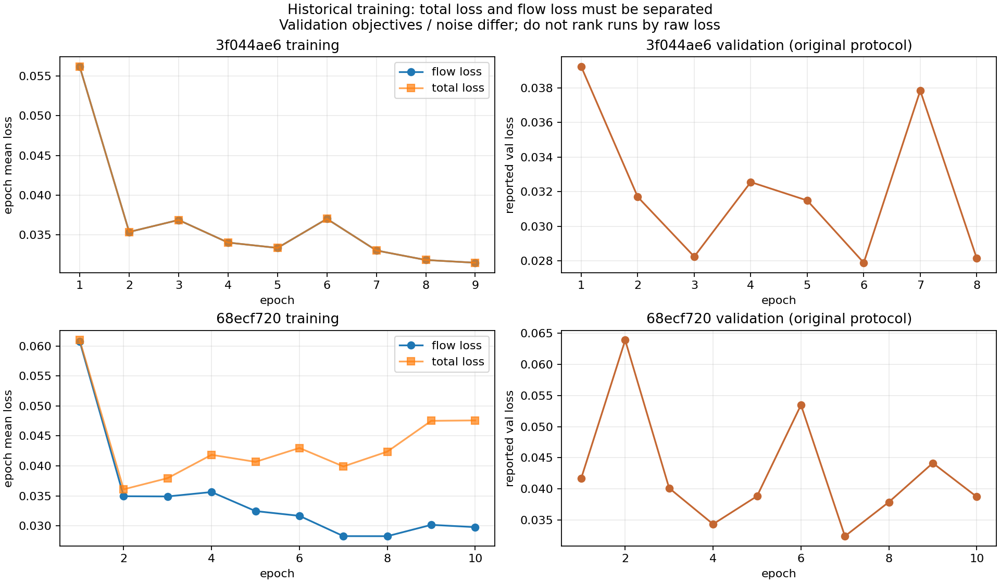

# Kontext既存学習の診断

更新日: 2026-10-31。対象は図面のノイズ除去・標準化 `default_train_simplified`。学習109組、検証10組。今回、新しい学習は開始していない。

認証・LoRA容量・凍結対象・LR・TOK・過学習の確認状況を含む更新用の一覧は [TRAINING_NOTES.md](../TRAINING_NOTES.md) を参照。このレポートは損失と画像評価の詳細を残す。

## 先に結論

「学習が全く進んでいなかった」とは考えにくい。flow lossは下がり、集計した主safetensors内のLoRA更新側B行列も全て非ゼロだった。一方、**学習していた目的と、必要な図面の画像品質が一致していない兆候がある**。単純にepochを30へ増やすだけでは改善を保証できない。

1回ごとに学習を終了し、固定条件の画像とログを診断して改善案を出す。次の投入はユーザーが決め、自動で再学習を繰り返さない。

## 実際の損失の推移

数値はstepごとの値ではなく、各epoch内の平均。

| 保存済み学習 | 進行 | 最初のflow loss | 最後のflow loss | 減少率 | 注意 |
| --- | --- | --- | --- | --- | --- |
| `68ecf720...` | 10epoch完了 | 0.06075 | 0.02979 | 約51% | 途中からlatent再構成lossの重みを増やしていた |
| `3f044ae6...` | 9epoch途中 | 0.05618 | 0.03147 | 約44% | 最後は48/55stepで途切れ、正常終了の記録がない |



初期に改善し、その後停滞が見られる。1件目ではflow lossが改善していても合計lossは増えているため、合計値だけを見ると「学習していない」と誤認しやすい。2件のval lossは目的関数・重み・乱数条件が違うので、生の最小値だけで優劣を決めない。

保存重みのヘッダーでは、transformerの実rankは `3f...` が64、`68...` が22。後者のCLIPは5、別保存T5は25。設定JSONの `rank=16` と同じではなかった。現在のコードは比率からrankを計算するため、次回はrankを明示指定する。

更新側B行列は `3f...` が495/495、`68...` が567/567で非ゼロ。通常のゼロ初期化を前提に、重みが更新されていたことを強く示す。ただし、非ゼロであること自体は画像品質の証明ではない。

これは主safetensors内の集計で、`68...` の別保存T5 LoRAの更新量は未集計。

根拠データ: `historical_training_summary.json`, `lora_rank_metadata.json`, `lora_update_statistics.json`。

## 損失の設計は悪いのか

現行の基本損失は、予測velocityと `noise - target_latents` のMSEであり、flow matchingの形として不自然なものではない。入力画像・正解画像の取り違えや、Kontext条件画像IDの設定にも、今回のコード照合で明らかな逆転は見つからなかった。条件画像のlatent IDを1にする処理は [Diffusers 0.37.1の実装](https://raw.githubusercontent.com/huggingface/diffusers/v0.37.1/src/diffusers/pipelines/flux/pipeline_flux_kontext.py) と一致する。

ただし、以下を区別する必要がある。

- flow lossの減少: ノイズ除去の予測誤差が減る。
- 実際に必要な精度: 家具・文字・床グリッドを消し、壁・窓・ドア・部屋の接続を保持する。

この2つは同じ評価ではない。背景が大半を占める図面で、平均的な誤差が減っても重要な細い線や開口が改善するとは限らない。

### latent再構成lossの意味

この実装では、丸め誤差を除いて次が成立する。

```text
x_t = (1 - sigma) * x0 + sigma * noise
v_target = noise - x0
x0_pred = x_t - sigma * v_pred

MSE(x0_pred, x0) = mean(sigma^2 * (v_pred - v_target)^2)
```

つまり、latent再構成lossを追加することは、主としてノイズ時刻に応じてflow誤差を重み付けし直すことに相当する。**壁や部屋の接続を直接測る新しい構造評価ではない。** 重みをepochとともに増やすと合計lossのスケールも変わる。CPUの数値テストでこの関係を検証した。

したがって、まずは標準flow lossを安定した基準とし、画像品質を別に測るのが妥当。latent再構成の重みを大きくすることだけを、精度向上策とはしない。

## 画像から分かった点

保存済みの旧 `3f...` のプレビューを確認した。epoch後半では文字や家具が薄くなっているが、残すべき壁も薄くなり、床グリッドが残る。正解の「白地に太い黒い壁」とは異なる。ユーザーが感じた改善不足を画像でも確認できた。

今回のベースモデルは、目的を明示したinstructionで寸法・文字を減らせる一方、家具やハッチングが残り、内部壁・開口の再現も不十分だった。4図面の補助的なwall IoU平均は約0.284。これは「正解率28.4%」ではなく、壁画素の重なりだけの指標である。

評価専用ジョブ `e4c69ec1516948a286d6858851621500` は19:51:44 JSTに終了し、ローカルへの取得も完了した。valの0290/0293/0296/0299を、固定seed・28steps・guidance3.5で評価した。

EC2は自動停止し、19:58:32 JSTにAWS APIで `stopped` を確認した。新しい学習・再起動は行っていない。

| 設定 | wall IoU平均 | 結果 |
| --- | --- | --- |
| ベース + 新しい明示instruction | 0.283675 | 4枚完了 |
| 旧B `3f044ae6…` + 旧TOK instruction | 0.013845 | 4枚完了 |
| 旧A `68ecf720…` | 未評価 | encoder LoRA読み込み時に `'default'` エラー |

旧Bの0290・0293の出力も実際に確認した。外壁の黒帯が細い線や断片へ変わり、内部の不要線・床グリッドが残っている。黒い壁の保持という要求を満たしていない。ただし、下記のとおりpromptが異なるため、この数値の差をLoRAの重みだけによる悪化と断定できない。

今回の旧比較ボードには未取得のbase列をpredictionで代用する旧コードの問題があり、診断には個別prediction PNGと真のbase/targetを用いた。次回用コードは修正済み。旧Aはadapter名を明示してencoderを復元する修正とCPUテストを追加したが、GPUでの再評価は未実行。

**学習用train画像での再現性は未確認。** 今回の推論画像も、これまで私が確認した旧プレビューもvalである。trainプレビューの取得はEC2停止と重なり接続できなかった。ユーザーのtrain再現不良の報告は重視するが、私が過学習の有無を確認したとは扱わない。train例の変換が悪いことだけでも、過学習を完全に否定できるわけではない。

### 比較条件の限界

今回、ベースは改善案の明示的なinstruction、既存モデルはそれぞれの学習時の `a photo of TOK floor plan.` を使っている。そのため、モデルの重みだけの効果を切り分けた比較ではなく、**各設定での実用的な出力の比較**である。promptの効果と重みの効果を混同しない。

検証10枚はこれまでモデル選定にも使われている。4枚の画像やIoUから、未知の図面全体への精度や「完璧」を保証しない。

## 確認・修正した評価上の問題

- 旧プレビューはseed+epochで生成しており、epochごとの画像差に乱数の影響が混ざっていた。固定seedに変更。
- 旧validationは乱数を固定せず、可変の再構成重みも含めていた。訓練の乱数状態を保ち、evalモードで固定ノイズを使い、flow目的で比較する処理へ変更。
- 最後の小さいバッチを同じ重みで平均していた。サンプル数で重み付けする平均へ変更。
- 既存adapter評価はmax_pairs省略時に最初の1組だけを使っていた。省略時は全組を対象に変更。
- cosine学習率が終端で初期値へ戻る境界処理を修正。ただし終端の記録値の問題だけで、過去の画像品質不足の主因と断定しない。
- rankを明示指定できる設定と、勾配ノルム・実optimizer更新回数の記録を追加。

## 次の1回の提案

最適な損失を既に確定したとは言えない。ユーザーからtrain画像も再現できないとの追加報告があるため、まず既存重みでのtrain入力の再現性と、保存・再読み込みでadapterが正しく適用されるかを確認する案を優先する。全体学習の前に、4～8組・拡張なしの暗記診断を1回行う案もある。いずれも自動では投入しない。以下は全体学習を選ぶ際の基準案。

1. **固定評価と明示的な変換instruction**: 入力、正解、未学習ベース、epochごとの出力を同じ検証図面・乱数・推論条件で保存する。文字だけでなく、壁・開口・接続と不要線の残りを目視する。
2. **学習の規模を明示**: transformer LoRA rank32、text encoderは固定、LR 5e-5を提案。まず10〜12epoch程度で確認し、上限は30。改善停滞時のLR低下・早期停止を使い、最終epochではなく画像で良かったcheckpointを選ぶ。これは未検証の候補であって、最適値の断定ではない。
3. **構造の改善が依然弱い場合にだけ損失を追加検討**: 次の候補は正解の壁・開口領域を重視する正規化した重み付けや、画像/境界指標を使う選定。latent再構成の係数追加だけで解決するとは考えない。評価基準と複数の損失を同時に大きく変えて効果を分からなくしない。

新しい学習はまだ開始していない。次の投入は、この診断を読んだユーザーが決める。

## 学習後の自動診断

学習完了後、取得済みの画像とlossをローカルのCodex CLIへ渡し、読み取り専用で日本語レポートを作る仕組みを追加した。シェル・ブラウザー操作を無効にし、次の学習の起動や設定編集を行わない指示を渡す。次の投入判断はユーザーに残す。仕様は [OpenAI Docsの非対話モード](https://learn.chatgpt.com/docs/non-interactive-mode) に基づく。

結果画面と `review/ai_review.md` で読む構成であり、このチャットへ新しいメッセージを勝手に投稿する構成ではない。PCがオフなら、結果取得後にレビューする。自動レビューの制御はモックを使ったテストで確認し、CLIとChatGPTログインは実環境で確認済み。今回の画像所見は、このチャットの私が実際に確認した。

追加したtrain2枚の学習前/終了時比較はval評価と区別する。自動診断が成功すると、ルートの `TRAINING_NOTES.md` の自動更新欄へ診断リンクを反映する。次の学習の投入・設定変更は行わない。CPUテスト43件成功。新しい画像評価付き学習全体と実モデルによる無人レビューの通し確認は未実施。
